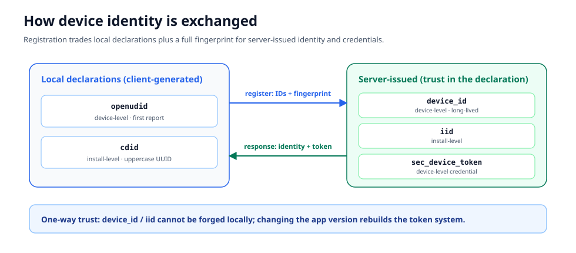

# Chapter 2: Device Identity and Fingerprint System

> 🎯 *"The trust relationship is one-way: openudid / cdid are local declarations, while device_id / iid are the server's trust in those declarations."*

## Chapter Overview

Device identity is not a single ID but a system made up of a set of identifiers, a fingerprint, and several encrypted carriers.

- The **four device identifiers** answer "who I am": `device_id`, `iid`, `openudid`, `cdid`;
- The **static fingerprint** answers "what device I claim to be";
- **Dynamic collection** answers "what environment I actually measure";
- **Encrypted carriers** are responsible for reporting the measurements credibly;
- The **four states** are the server's final decision on all of the above.

## 🎓 Learning Objectives

After completing this chapter, you should be able to:

- ✅ Explain the generator, lifecycle, and direction of trust for the four identifiers;
- ✅ Give two static-fingerprint examples where "a single field is valid but the combination is contradictory";
- ✅ Distinguish the division of labor among the three carriers SDI, dtrait, and TicketGuard;
- ✅ Explain why the `ri` report must use on-device parameters;
- ✅ Correctly understand the `empty` state, and not mistake "no data" for "device unavailable".

## 📚 Chapter Structure

| Section | Topic | Keywords |
|---|---|---|
| 2.1 | The four device identifiers | device_id, iid, openudid, cdid |
| 2.2 | Static fingerprint | device model templates, combination plausibility |
| 2.3 | Dynamic fingerprint | MSSDK collectors, environment detection, behavioral features |
| 2.4 | Encrypted carriers | SDI body, dtrait, TicketGuard |
| 2.5 | Risk-control decisions | success / empty / blocked / error |

## 🔑 Key Takeaways

1. **Identity is exchanged for**: local declarations (openudid, cdid) + a complete fingerprint → server-issued credentials (device_id, iid, sec_device_token).
2. **The risk in a static fingerprint lies in the combination, not in individual fields**: contradictions between resolution and dpi, or between API level and ROM string, are focal points for collector cross-validation.
3. **Static is declaration; dynamic is measurement**: the two must match.
4. **One fact has two encodings**: SDI and dtrait must both be reproduced completely; the server cross-checks them.
5. **empty is not failure**: during the cold start of a new device, an empty page is normal; device availability should be judged by `search_ok`.

> 👉 Next section: [2.1 The Four Device Identifiers](./01_four_ids.md)
