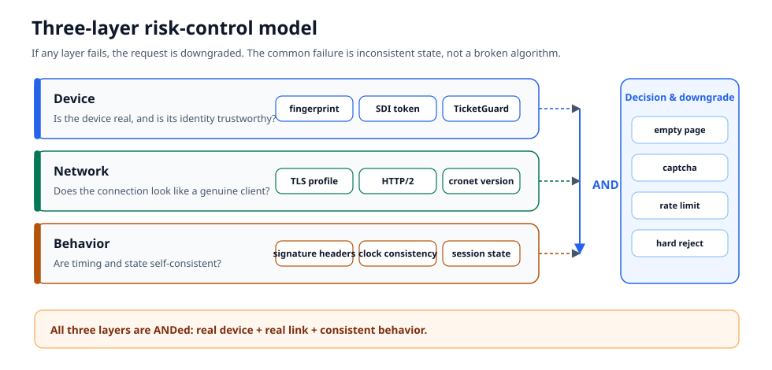

# Chapter 1: Risk Control System Overview

> 🎯 *"Douyin's risk control is not a single-point check, but a three-layer progressive system."*

## Chapter overview

Before any specific parameter, a more basic question has to be answered: **what is the server actually verifying?**

The original's answer is three layers: device layer, network layer, behavior layer. The three are an AND relationship — if any layer fails, the request is downgraded: an empty page is returned, a CAPTCHA is shown, rate limiting kicks in, or the request is rejected outright.

The easiest pitfall is not "an algorithm was computed wrong", but **inconsistent state**: each header looks valid on its own, yet they contradict each other in combination.

## 🎓 Learning objectives

After completing this chapter, you should be able to:

- ✅ Draw the division of labor among the device layer / network layer / behavior layer, and explain why they form an AND relationship;
- ✅ Distinguish the seven signature headers from the plaintext context headers, and understand "declaration vs proof";
- ✅ Map each signature header to its corresponding native library;
- ✅ State the two most important algorithm changes around 41.1;
- ✅ Explain why process-wide shared state is key to a simulated implementation.

## 📚 Chapter structure

| Section | Topic | Keywords |
|---|---|---|
| 1.1 | Three-layer risk control model | device / network / behavior, downgrade |
| 1.2 | Seven signature headers and plaintext context | Khronos, Argus, Gorgon, Ladon, Helios, Medusa, Perseus |
| 1.3 | Local SDK component mapping | MSSDK, Sword, Badger, Cronet |
| 1.4 | Version evolution | 39.4 → 41.2, 41.1 boundary |

## 🔑 Key conclusions

1. **The three layers are AND**: a real device + a real link + self-consistent behavior; none can be missing.
2. **Plaintext headers are declarations, signature headers are proofs**: the server reads the declaration first, then reverse-derives decryption through the signature headers and verifies that the two agree.
3. **A declaration/proof mismatch is more common than a wrong signature**: this is the main source of risk control hits.
4. **Four native libraries share the same process state**: clock origin, session UUID, KD storage, token cache. If each header computes on its own, the combination will inevitably fail.
5. **41.1 is the boundary**: Medusa switches from short frames to v412 long frames; field13 changes from "content selects the branch" to "khronos selects the branch"; Perseus is enabled.

> 👉 Next: [1.1 Three-Layer Risk Control Model](./01_layers.md)
