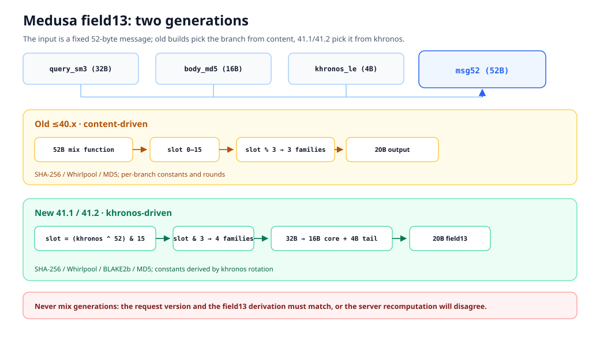

# Chapter 4: Core Request Parameter Breakdown

> 🎯 *"This part is the algorithmic core of the book, and the place most prone to 'every header is right on its own, but the combination is wrong'."*

## Chapter overview

The previous two chapters covered "identity" and "registration"; this chapter turns to the request itself.

A single request carries at least four parameter groups that reference one another:

1. `x-common-params-v2`: the public declaration of device and version;
2. `X-Khronos`: the time anchor for all signature headers;
3. `X-Medusa`: the device-state long frame, centered on field13;
4. `X-Perseus` / `X-Gorgon`: device reporting and request binding.

They are not independent. `khronos` affects the field13 branch; field13 enters the Medusa report; and the Medusa report is in turn cross-checked against Perseus's session state.

## 🎓 Learning objectives

After completing this chapter, you should be able to:

- ✅ state the consistency constraints linking `x-common-params-v2` to the UA, the registration body, and the query;
- ✅ explain the suite1 constraint on `X-Khronos` and why it affects field13;
- ✅ write out the composition of `msg52`;
- ✅ compare the old "content selects the branch" scheme with the new "khronos selects the branch" scheme;
- ✅ explain why Perseus's FL chain can be reproduced offline;
- ✅ explain why KD must be shared process-wide and persisted across sessions;
- ✅ describe how Gorgon binds the request body.

## 📚 Chapter structure

| Section | Topic | Keywords |
|---|---|---|
| 4.1 | `x-common-params-v2` | 30 keys, four-way consistency |
| 4.2 | `X-Khronos` and suite | time anchor, `ts & 7 == 1` |
| 4.3 | `X-Medusa` | short frame / long frame, field13, three families / four families |
| 4.4 | f17 clock slot and session | monotonicity, session_uuid, eight-branch question |
| 4.5 | `X-Perseus`: FL | seed, k, chain, thread_word |
| 4.6 | `X-Perseus`: KD and reporting | pd, fkd, protobuf, address patterns |
| 4.7 | `X-Gorgon` | STUB, URL digest, anti-replay |
| 4.8 | Version differences and implementation constraints | the two versions cannot be mixed |

## 🔑 Key conclusions of this chapter

1. **`version_name` is explicitly validated at the signing entry point**: when the version declared in the query differs from the device template version, signing is rejected outright.
2. **`khronos` is more than a timestamp**: since 41.1 it determines the Medusa field13 branch selection.
3. **field13 input is fixed at 52 bytes**: `query_sm3(32B) || body_md5(16B) || khronos_le(4B)`.
4. **The old version is content-driven, the new version khronos-driven**: the two algorithm sets cannot be mixed.
5. **FL is deterministic**: the same `(seed, k, flags)` always yields the same chain values, which can be verified byte by byte offline.
6. **KD is process state, not a request parameter**: generating KD independently for each request exposes timing characteristics.
7. **Gorgon binds the request body**: change one byte of the body without updating STUB and it fails immediately.

> 👉 Next section: [4.1 x-common-params-v2](./01_common_params.md)
