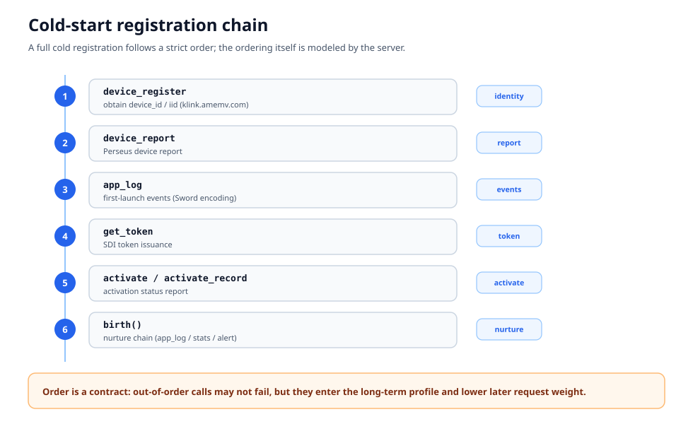

# Chapter 3: Device Registration Flow

> 🎯 *"Order is the contract."*

## Chapter Overview

Registration is not "sending one device_register request"; it is a cold-start chain of six steps:

1. Establish the clock baseline first;
2. Register the device identity;
3. Send the device report;
4. Send the first-launch events;
5. Obtain the SDI token;
6. Complete activation and the nurture chain.

Each step depends on the state produced by the previous one, and the server records the timing of the entire chain.

## 🎓 Learning Objectives

After completing this chapter, you should be able to:

- ✅ Write the constraint `boot_time ≤ first_launch ≤ app_start ≤ request time`, and explain why an inversion is anomalous;
- ✅ Restate the order of the six-step registration chain and the output of each step;
- ✅ State the five groups of the registration plaintext;
- ✅ Distinguish the lifecycles of `sec_device_token` and SDI token;
- ✅ Explain why "finishing registration plus nurture within 1 second" is itself an anomalous signature;
- ✅ Explain the role of TrustChain warm-up.

## 📚 Chapter Structure

| Section | Topic | Keywords |
|---|---|---|
| 3.1 | Cold start sequence and clock baseline | boot_time, app_start, session clock |
| 3.2 | Registration chain breakdown | device_register, device_report, app_log, get_token, activate, birth |
| 3.3 | Registration plaintext body structure | device declaration, version declaration, identity seed, environment, Medusa clock |
| 3.4 | Two kinds of token | sec_device_token, SDI token |
| 3.5 | Nurture and activation chains | app_log, stats_collect, app_alert_check |
| 3.6 | TrustChain warm-up | pre-register, pre-search warm-up |

## 🔑 Key Takeaways

1. **The clock must be pinned first**: all subsequent signatures and reports depend on the same set of clock baselines.
2. **Order is the contract**: out-of-order does not necessarily fail, but it enters the long-term profile and lowers weight.
3. **The registration body is a declaration**: the five groups—device, version, identity, environment, clock—must be consistent with everything else.
4. **The two token types have different lifecycles**: `sec_device_token` is long-lived; the SDI token is short-lived.
5. **Behavioral timing is modeled**: a real device's chain naturally has second-level gaps; finishing everything within seconds is instead anomalous.
6. **TrustChain warm-up cannot be skipped**: searching immediately after skipping warm-up significantly raises the probability of `empty`.

> 👉 Next section: [3.1 Cold Start Sequence and Clock Baseline](./01_cold_start_clock.md)
