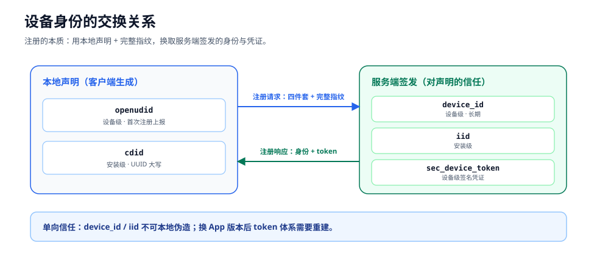

# 第2章 设备身份与指纹体系

> 🎯 *“信任关系是单向的：openudid / cdid 是本地声明，device_id / iid 是服务端对声明的信任。”*

## 本章概览

设备身份不是一个 ID，而是一组标识、一份指纹、几套加密载体共同构成的体系。

- **四件套**回答“我是谁”：`device_id`、`iid`、`openudid`、`cdid`；
- **静态指纹**回答“我声称自己是什么设备”；
- **动态采集**回答“我实际测量到的环境是什么”；
- **加密载体**负责把测量结果可信地上报；
- **四种状态**是服务端对这一切的最终判定。

## 🎓 学习目标

完成本章后，你应该能够：

- ✅ 说清四个标识的生成方、生命周期与信任方向；
- ✅ 举出两个“单字段合法、组合矛盾”的静态指纹例子；
- ✅ 区分 SDI、dtrait、TicketGuard 三套载体的分工；
- ✅ 解释 `ri` 报告为什么要用本机参数；
- ✅ 正确理解 `empty` 状态，不把“没有数据”误判为“设备不可用”。

## 📚 本章结构

| 小节 | 主题 | 关键词 |
|---|---|---|
| 2.1 | 设备标识四件套 | device_id、iid、openudid、cdid |
| 2.2 | 静态指纹 | 机型模板、组合合理性 |
| 2.3 | 动态指纹 | MSSDK 采集器、环境检测、行为特征 |
| 2.4 | 加密载体 | SDI body、dtrait、TicketGuard |
| 2.5 | 风控决策 | success / empty / blocked / error |

## 🔑 本章关键结论

1. **身份是交换来的**：本地声明（openudid、cdid）+ 完整指纹 → 服务端签发（device_id、iid、sec_device_token）。
2. **静态指纹的风险在组合，不在单字段**：分辨率与 dpi 矛盾、API level 与 ROM 字符串矛盾，都是采集器交叉验证的重点。
3. **静态是声明，动态是测量**：两者必须匹配。
4. **同一事实有两份编码**：SDI 与 dtrait 必须都完整复现，服务端会交叉比对。
5. **empty 不是失败**：新设备冷启阶段出现空页是正常的，判断设备可用应看 `search_ok`。

> 👉 下一节：[2.1 设备标识四件套](./01_four_ids.md)
