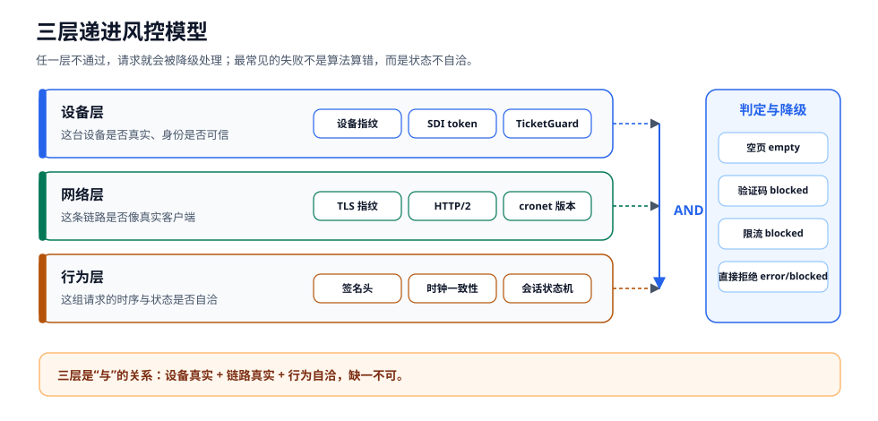

# 第1章 风控体系总览

> 🎯 *“某音的风控不是单点校验，而是三层递进的体系。”*

## 本章概览

在进入任何具体参数之前，先要回答一个更基础的问题：**服务端到底在验证什么？**

原文给出的答案是三层：设备层、网络层、行为层。三层之间是“与”的关系——任何一层不过关，请求都会被降级处理：返回空页、弹验证码、限流，或者直接拒绝。

最容易踩的坑不是“某个算法算错了”，而是**状态不自洽**：每个头单独看都合法，组合起来却互相矛盾。

## 🎓 学习目标

完成本章后，你应该能够：

- ✅ 画出设备层 / 网络层 / 行为层的分工，并说明它们为什么是 AND 关系；
- ✅ 区分七神签名组与明文上下文组，理解“声明 vs 证明”；
- ✅ 把每个签名头映射到对应的 native 库；
- ✅ 说出 41.1 前后最核心的两处算法变化；
- ✅ 解释为什么“共享进程状态”是模拟实现的关键。

## 📚 本章结构

| 小节 | 主题 | 关键词 |
|---|---|---|
| 1.1 | 三层风控模型 | 设备 / 网络 / 行为、降级 |
| 1.2 | 七神签名组与明文上下文 | Khronos、Argus、Gorgon、Ladon、Helios、Medusa、Perseus |
| 1.3 | 本地 SDK 组件对应关系 | MSSDK、Sword、Badger、Cronet |
| 1.4 | 版本演进 | 39.4 → 41.2、41.1 分界 |

## 🔑 本章关键结论

1. **三层是 AND**：设备真实 + 链路真实 + 行为自洽，缺一不可。
2. **明文头是声明，签名头是证明**：服务端先读声明，再用签名头反推解密，验证两者一致。
3. **声明与证明不符，比算错签名更常见**：这是风控命中的主要来源。
4. **四个 native 库共享同一进程状态**：时钟起点、会话 UUID、KD 存储、token 缓存。各头各算各的，必然组合失败。
5. **41.1 是分界**：Medusa 从短帧切到 v412 长帧；field13 从“内容选分支”改成“khronos 选分支”；Perseus 启用。

> 👉 下一节：[1.1 三层风控模型](./01_layers.md)
