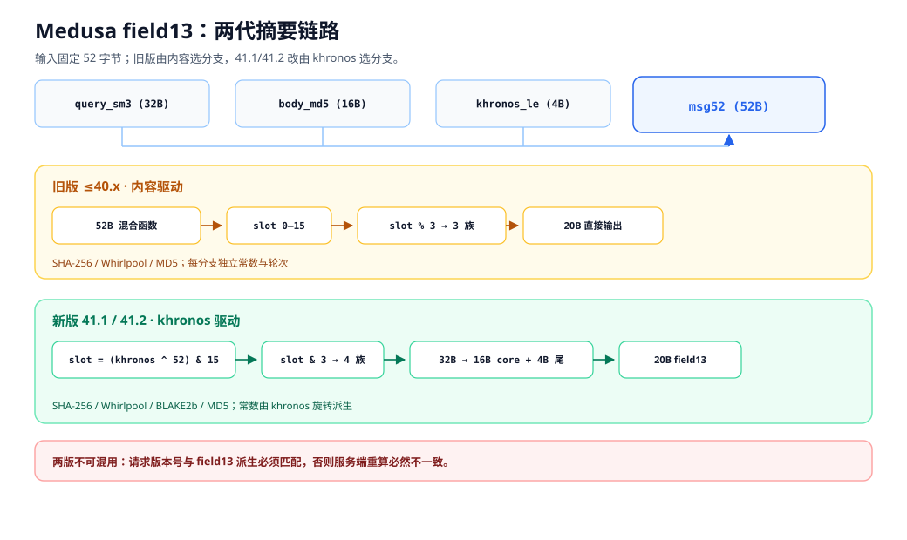

# 第4章 核心请求参数拆解

> 🎯 *“这一部分是全书的算法核心，也是最容易‘每个头都对、组合起来错’的地方。”*

## 本章概览

前两章讲的是“身份”和“注册”，本章进入请求本身。

一条请求上至少有四组参数在互相引用：

1. `x-common-params-v2`：设备与版本的公共声明；
2. `X-Khronos`：所有签名头的时间锚点；
3. `X-Medusa`：设备状态长帧，核心是 field13；
4. `X-Perseus` / `X-Gorgon`：设备报告与请求绑定。

它们不是独立的。`khronos` 会影响 field13 的分支；field13 会进入 Medusa 报告；Medusa 报告又会与 Perseus 的会话状态交叉校验。

## 🎓 学习目标

完成本章后，你应该能够：

- ✅ 说出 `x-common-params-v2` 与 UA、注册体、query 的一致性约束；
- ✅ 解释 `X-Khronos` 的 suite1 约束，以及它为什么会影响 field13；
- ✅ 写出 `msg52` 的组成；
- ✅ 对比旧版“内容选分支”和新版“khronos 选分支”；
- ✅ 解释 Perseus 的 FL 链为什么可离线复现；
- ✅ 解释 KD 为什么必须进程内共享、跨会话持久化；
- ✅ 说出 Gorgon 如何绑定请求体。

## 📚 本章结构

| 小节 | 主题 | 关键词 |
|---|---|---|
| 4.1 | `x-common-params-v2` | 30 键、四处一致 |
| 4.2 | `X-Khronos` 与 suite | 时间锚点、`ts & 7 == 1` |
| 4.3 | `X-Medusa` | 短帧 / 长帧、field13、三族 / 四族 |
| 4.4 | f17 时钟槽与会话 | 单调性、session_uuid、八分支疑问 |
| 4.5 | `X-Perseus`：FL | seed、k、chain、thread_word |
| 4.6 | `X-Perseus`：KD 与报告 | pd、fkd、protobuf、地址规律 |
| 4.7 | `X-Gorgon` | STUB、URL 摘要、防重放 |
| 4.8 | 版本差异与实现约束 | 两版不可混用 |

## 🔑 本章关键结论

1. **`version_name` 在签名入口有显式校验**：query 声明的版本与设备模板版本不符时，直接拒绝签名。
2. **`khronos` 不只是时间戳**：41.1 起它决定 Medusa field13 的分支选择。
3. **field13 输入固定 52 字节**：`query_sm3(32B) || body_md5(16B) || khronos_le(4B)`。
4. **旧版内容驱动、新版 khronos 驱动**：两套算法不能混用。
5. **FL 是确定性的**：同一组 `(seed, k, flags)` 永远得到同一组链值，可离线逐字节验证。
6. **KD 是进程状态，不是请求参数**：每个请求独立生成 KD 会暴露时序特征。
7. **Gorgon 绑定请求体**：body 改一个字节而 STUB 不同步，立即失败。

> 👉 下一节：[4.1 x-common-params-v2](./01_common_params.md)
