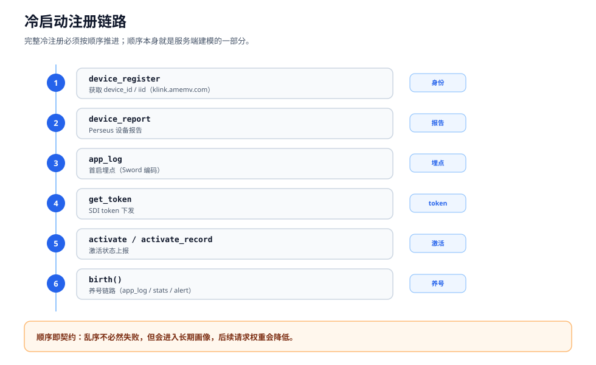

# 第3章 设备注册流程

> 🎯 *“顺序即契约。”*

## 本章概览

注册不是“发一个 device_register 请求”，而是一条包含六步的冷启动链路：

1. 先确定时钟基准；
2. 注册设备身份；
3. 上报设备报告；
4. 发送首启埋点；
5. 获取 SDI token；
6. 完成激活与养号。

每一步都依赖前一步的状态，且服务端会记录整条链路的时序。

## 🎓 学习目标

完成本章后，你应该能够：

- ✅ 写出 `boot_time ≤ first_launch ≤ app_start ≤ 请求时刻` 的约束，并解释倒置为什么异常；
- ✅ 复述六步注册链路的顺序与每步产出；
- ✅ 说出注册明文的五个分组；
- ✅ 区分 `sec_device_token` 与 SDI token 的生命周期；
- ✅ 解释“1 秒内打完注册 + 养号”为什么本身就是异常特征；
- ✅ 解释 TrustChain 预热的作用。

## 📚 本章结构

| 小节 | 主题 | 关键词 |
|---|---|---|
| 3.1 | 冷启动时序与时钟基准 | boot_time、app_start、会话时钟 |
| 3.2 | 注册链路分解 | device_register、device_report、app_log、get_token、activate、birth |
| 3.3 | 注册明文体结构 | 设备声明、版本声明、身份种子、环境、Medusa 时钟 |
| 3.4 | 两类 token | sec_device_token、SDI token |
| 3.5 | 养号与激活链路 | app_log、stats_collect、app_alert_check |
| 3.6 | TrustChain 预热 | pre-register、搜索前预热 |

## 🔑 本章关键结论

1. **时钟必须先钉住**：所有后续签名和报告都依赖同一组时钟基准。
2. **顺序是契约**：乱序不必然失败，但会进入长期画像并降低权重。
3. **注册体是声明**：设备、版本、身份、环境、时钟五组必须与其他地方一致。
4. **两类 token 生命周期不同**：`sec_device_token` 长期，SDI token 短周期。
5. **行为时序会被建模**：真实设备的链路天然带秒级间隔，秒级内全打完反而异常。
6. **TrustChain 预热不能省**：跳过预热直接搜索，`empty` 概率显著上升。

> 👉 下一节：[3.1 冷启动时序与时钟基准](./01_cold_start_clock.md)
